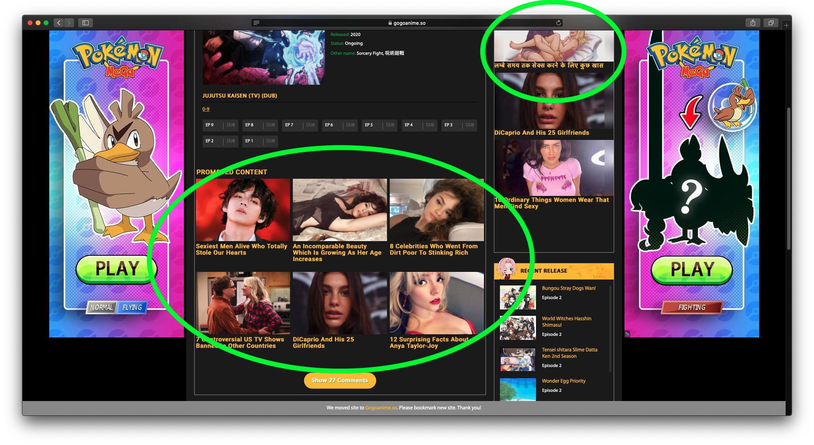

# weeb-box

A Go TUI for watching and downloading anime from multiple sources. The home dashboard shows continue-watching, recent searches, and stats. Search a title across every provider, pick a series and source, then stream an episode with mpv/ffplay or download one episode, the rest of the season, or everything from the selected episode on.

## Prerequisites

- Go 1.27.3 or newer to build (see `go.mod`)
- `ffmpeg` and `ffprobe` on `PATH` — downloads and progress
- `mpv` strongly recommended — on-screen controls, subtitles, and resume. `ffplay` works as a fallback but has only basic keyboard controls and no live progress saving.

## Run

```sh
go run .                                  # default paths
go run . -dir ~/Videos/anime              # custom download root
go run . -db /tmp/weeb-box.db             # custom database
go run . -base https://gogoanime.example  # alternate mirror host
go run . -library ~/Videos/anime          # browse an existing collection
```

Build a binary:

```sh
go build -o bin/weeb-box .
./bin/weeb-box
```

Check the external tools and see exact install commands:

```sh
go run . -check
```

On first launch, if anything is missing, the TUI opens a **Setup** screen with
the same status and commands. Press `r` to recheck after installing, or
`enter`/`esc` to continue without the optional pieces.

| flag    | meaning             | default                                        |
| ------- | ------------------- | ---------------------------------------------- |
| `-dir`  | download root       | `~/Downloads/weeb-box`                         |
| `-db`   | SQLite database     | platform app-data path (see below)             |
| `-base` | gogoanime base URL  | `https://gogoanime.or.at`                      |
| `-library` | local library root | same as `-dir`                              |

## Keys

Global: `ctrl+c` cancels a running download or playback and quits. `q` quits from any screen except the focused search box, where it is typed as text. `ctrl+h` toggles help anywhere; `?` is a shortcut outside the search box. `ctrl+l` opens the downloaded library; `ctrl+p` opens the provider list; `ctrl+b` browses genres; `ctrl+o` opens Settings.

| screen  | keys |
| ------- | ---- |
| home — search focused | type a query, `enter` search, `tab`/`↓` move to lists, `esc` quit |
| home — continue watching / recent searches | `↑`/`↓` move, `tab` next list, `enter` resume or re-run search, `esc` or `/` back to search box, `ctrl+r` clear search history (recent searches only), `q` quit |
| results | `↑`/`↓` move, `enter` open episodes, `i` view cover, `v` view download queue, `esc` home |
| episodes | `↑`/`↓` move, `enter` play, `d` download selected, `a` download from selected to the end, `i` view cover, `v` view queue, `esc` back |
| downloads | `x` cancel, `r` retry last failed episode, `o` open folder, `esc` back |
| library | `↑`/`↓` move, `enter` play the local file, `o` open folder, `r` rescan, `esc` home |
| providers | `space`/`enter` enable or disable, `r` refresh status, `esc` back |
| browse | `↑`/`↓` genre or title, `n`/`]` next page, `p`/`[` previous page, `i` view cover, `enter` drill in/search providers, `esc` back |
| settings | `↑`/`↓` row, `space`/`←`/`→` cycle quality or theme, `space`/`enter` toggle Hide adult, `enter` edit download dir, `esc` back |
| setup | `r` recheck dependencies, `enter`/`esc` continue |

Only one download job runs at a time; starting a queue stops at the first failure. `r` retries only the last failed episode, not a cancelled queue.

Playback suspends the TUI until the player exits. mpv gets the OSC, resume, live progress, and the default subtitle track (English when available); `v` hides/shows subtitles, `j` cycles tracks, and the uosc CC button toggles them. ffplay gets basic keyboard controls but no live progress or subtitles. mpv streams HLS on demand with a short forward buffer (around 15–30 seconds), so it does not fetch the whole episode ahead of time.

For a modern control bar, install [uosc](https://github.com/tomasklaen/uosc) and copy `themes/mpv/uosc.conf` to `~/.config/mpv/script-opts/uosc.conf`. The app auto-detects uosc and disables the built-in OSC; the theme replaces `master.m3u8` with the anime/episode title. Re-copy that config after updating to pick up the CC toggle.

Mouse: wheel scrolls the list under the pointer; click a row to select it, click it again (or double-click) to open/play. On the episode detail panel, clicking Play/Download/Download-from-here runs that action. Terminal text selection may need Shift or Option while mouse reporting is on.

The download queue shows percentage, bytes written, ffmpeg speed, and ETA while active, plus the final file size when complete. Long titles auto-scroll horizontally in resume/recent rows, search results, the library, and the download queue.

## Storage

Videos:

```
<dir>/<provider>/<anime>/<anime> - E001.mp4
```

Downloads stream through ffmpeg into `<file>.mp4.part` and are renamed on success. Existing non-empty files are skipped (and indexed); zero-byte leftovers are overwritten. When captions exist, the English/default track is saved as `<video>.vtt` next to the episode, so mpv and VLC auto-load it.

Database (SQLite, WAL): search history, watch progress, and the download index.

| platform | default path |
| -------- | ------------ |
| macOS | `~/Library/Application Support/weeb-box/weeb-box.db` |
| Linux | `$XDG_DATA_HOME/weeb-box/weeb-box.db`, else `~/.local/share/weeb-box/weeb-box.db` |
| Windows | `%LOCALAPPDATA%\weeb-box\weeb-box.db`, else `%USERPROFILE%\AppData\Local\weeb-box\weeb-box.db` |

Override with `-db`. The help screen (`ctrl+h`) shows the active video and database paths.

The Library (`ctrl+l`) scans the download root—or a separate `-library` root—for `mp4`, `mkv`, `webm`, `avi`, `mov`, `m4v`, and `ts` files. It reads `<anime> - E001.mp4` names, shows size/date/subtitle/progress state, and plays the file directly with mpv, including resume. Local progress is stored under the `local` provider, so downloaded episodes also appear in Continue watching.

## Providers

Search runs against all enabled providers in parallel. Results show their source; selecting a result pins that provider for episodes, playback, and downloads. `ctrl+p` lists each provider with its URL, enabled state, and the time of its last successful search, and lets you disable sources you do not want. Toggles persist in SQLite.

| provider | site | search |
| --- | --- | --- |
| `gogoanime` | gogoanime.or.at | HTML |
| `animekai` | animekai.com.co | WordPress REST |
| `anizone` | anizone.io | WordPress REST (`az_series`) |
| `kissanime` | kissanime.com.cv | WordPress REST |
| `hianime` | hianime.ms | HTML |

The MegaPlay resolver (data-id → encrypted sources → HLS + WebVTT) is shared by all providers in `internal/provider/megaplay`.

`internal/provider` defines `Provider` (`Name`, `Search`, `Episodes`, `Stream`). To add a source, implement it in `internal/provider/<name>` and add it to the registry in `main.go`. `Stream` returns a media URL, optional `Referer`, and optional subtitle tracks, which `internal/media` forwards to ffmpeg, ffprobe, mpv, or ffplay.

`-base` overrides the gogoanime host only; the other providers use their defaults.

KissAnime.tv.in was evaluated but is not wired yet: its search is an AJAX/CSRF endpoint and its player path needs a dedicated adapter.

## Metadata, covers, and categories

The TUI enriches a selected title with public metadata:

- **AniList** — cover, genres, tags, adult flag, score, description
- **Kitsu** — age rating (`G`, `PG-13`, `R`, `18+`), with **Jikan** as fallback
- **SQLite cache** — seven-day TTL, so lookups do not repeat on every selection

At **100+ columns**, the Results/Browse screens show a right-hand preview with a
cover rendered as colored half-blocks; low-color terminals fall back to ASCII.
Narrower terminals keep the compact rating/genres line, and the episode detail
pane shows rating, genres, and tags.

Press `i` on Results, Browse, or Episodes to open the selected title's cover.
iTerm2 and Kitty draw it inline through their own image protocol; other
terminals get a 60x30 half-block viewer with title, rating, genres, and tags
(`esc`/`enter` back).

`ctrl+b` opens **Browse by genre**. Pick a genre, then a title, and the normal
multi-provider search runs for that title. `n`/`]` and `p`/`[` page through the
popular list; an empty page reports "no more titles". AniList browse is
non-adult; search results are not filtered by rating unless **Hide adult** is
enabled in Settings.

## Settings

`ctrl+o` opens preferences:

- **Preferred quality** — `auto`, `1080p`, `720p`, or `480p`. `auto` probes the connection and picks a variant with headroom; explicit modes prefer that height and fall back lower.
- **Download directory** — editable and persisted. `-dir` overrides it for that run; existing files are not moved.
- **Database** — shows the active SQLite path. Changing it requires restarting with `-db`.
- **Providers** — enabled/total count; press `ctrl+p` to choose which sources search uses.
- **Hide adult** — yes/no. Off by default, so `18+` badges show normally. When on, an adult result's preview reads "18+ hidden" and `enter`/`i` refuse to open it. Provider results are never filtered ahead of time.
- **Color theme** — Carbon Dark, Carbon Light, Tokyo Night, or Mono. This changes TUI colors; the font remains a terminal setting (IBM Plex Mono recommended).

The selected quality applies to playback and downloads. The database and download paths are shown in the help screen too.

The header shows `(developed by @chotathanos)` as a clickable link to [x.com/chotathanos](https://x.com/chotathanos).

## Theme

The interface uses an IBM Carbon dark palette and looks best in **IBM Plex
Mono**. A terminal app cannot set its own font, so choose it in your terminal;
[`themes/README.md`](themes/README.md) has install steps plus ready-made
Alacritty and Kitty color configs.

## Tests

```sh
go test ./...
```

Unit tests include a local HLS download through the real ffmpeg path, so
`ffmpeg` is required for the full suite (the test skips if it is missing).

Live checks hit the real site and are gated:

```sh
WEEB_LIVE=1 go test ./internal/provider/gogo -run Live -v
WEEB_LIVE=1 go test ./internal/media -run Live -v
```

## Why not just use the website?

Pop-ups and malicious ads.

